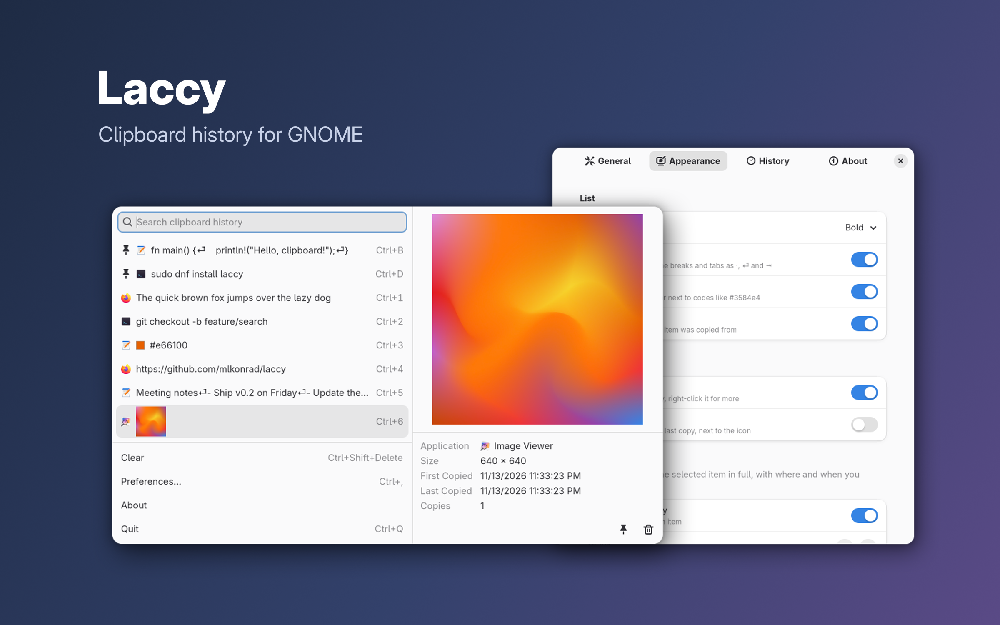
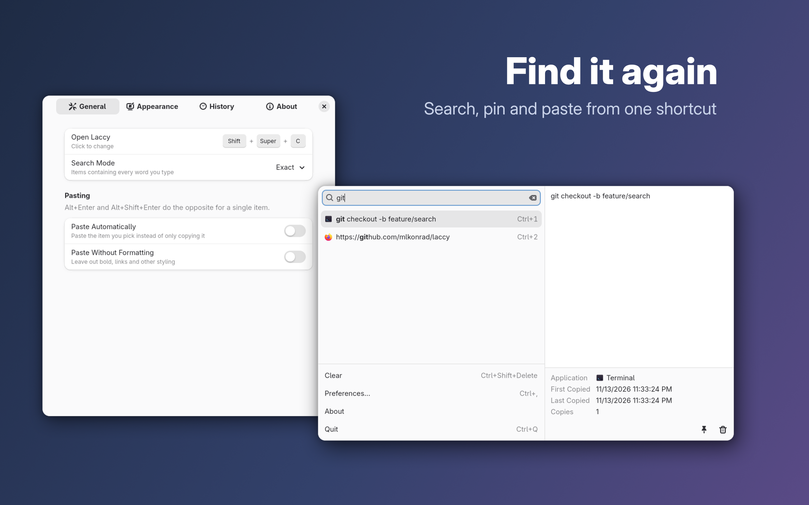

<p align="center">
  
</p>

# Laccy

A lightweight, keyboard-first clipboard manager for GNOME, inspired by
[Maccy](https://github.com/p0deje/Maccy). Click the clipboard icon in the top
bar (or press a shortcut you set in [Preferences](#preferences)), type to
search, press **Enter** to copy, then paste wherever you like.





Laccy is an independent project. It is not affiliated with Maccy and doesn't
share any code with it.

## Status

Early scaffold. It records and pastes text, images and files on GNOME 50 and 51 (Wayland).
See the [roadmap](#roadmap).

## How it works

GNOME doesn't let regular apps watch the clipboard, register global shortcuts
or type keys. Laccy is therefore three small parts:

```
 GNOME Shell extension (JS, runs inside gnome-shell)
   ├─ clipboard changed ──AddText/AddImage/AddFiles──▶ laccyd (Rust, no UI)
   │                                   └─ SQLite ~/.local/share/laccy/history.db
   ├─ top bar menu and label ──Clear/Latest──▶ laccyd
   ├─ your shortcut ──launches──▶ laccy popup (Rust, GTK 4 + libadwaita)
   │                                   └─ reads the same database, reloads on laccyd's HistoryChanged
   └─ ◀──SetClipboard/SetContent── laccy, when an item is picked
        sets the clipboard, then sends Ctrl+V if asked
```

| Part | Where | Role |
|---|---|---|
| `extension/laccy@mlkonrad.github.com` | inside gnome-shell | Watches the clipboard, handles the shortcut, sets the clipboard and pastes |
| `crates/laccyd` | background, D-Bus activated | Stores copies; only glib and SQLite, no GTK |
| `crates/laccy` | runs only while a window is open | The popup (search, pick, pin, delete) and the preferences window |
| `crates/laccy-core` | library | History database, search, settings, D-Bus names |

**Keeping it lightweight:** no GTK process runs while the popup is hidden.
`laccy` starts on the shortcut and exits when it closes, `laccyd` is the only
thing that stays running (except after you pick [formatted text](#images-files-and-formatted-text)),
and the popup loads only a 10,000-character excerpt
of each item. Images show as small thumbnails, made once when they're copied
by a `laccy --thumbnail` process that exits right away (image decoders hold on
to memory, so they never load in `laccyd`). The popup only decodes the
thumbnails on screen. It opens and closes without GNOME's window animations,
and its text cursor doesn't blink, because the fade redraws the whole popup
every frame.

The popup renders with GTK's Cairo renderer instead of the GPU. Measured on
GNOME 50 with 200 items (median of warm launches):

| Renderer | Startup CPU | Resident memory | Private memory |
|---|---|---|---|
| Vulkan (GTK default) | 515 ms | 180 MB | 54 MB |
| OpenGL | 415 ms | 150 MB | 43 MB |
| **Cairo (Laccy default)** | **300 ms** | **60 MB** | **17 MB** |

Set `GSK_RENDERER` to override it. `laccyd` uses about 9 MB resident, 0.7 MB private.
Copied images pass through it, so after large ones it keeps up to about two
images' worth of buffers: 12 MB more private memory after 6 MB screenshots.

**Privacy:** copies marked as secret by password managers
(`x-kde-passwordManagerHint`) are never recorded, and you can ignore whole
apps or copies matching a pattern, like API keys (see [Preferences](#preferences)).
You can also pause recording, or skip just the next copy, from the
[top bar icon](#top-bar-icon). Nothing is recorded while the
screen is locked, because GNOME disables extensions then. History never
leaves your machine. Deleted and cleared items are overwritten with zeros in
the history file (SQLite's `secure_delete`), so they can't be recovered from
it afterwards. The history file and its folder can only be read by you
(modes 0600 and 0700).

**Security:** any program on the session bus can call D-Bus methods, so each
side checks who is calling. laccyd only answers GNOME Shell (the owner of
`org.gnome.Shell`), so other programs can't add fake items, read the latest
copy or clear the history. The extension only sets the clipboard or pastes
for a process running the `laccy` binary that Laccy's desktop file launches,
so other programs can't use it to replace what you copied or type into
the focused app.

## Images, files and formatted text

- **Files** copied in Files (or any app that copies a list of `file://` URIs) are recorded as files. Picking them copies the files again, so you can paste them into a folder or an upload dialog. Search matches their paths.
- **Images** (screenshots, *Copy Image* in a browser) are recorded when the app offers an image and no text. Apps that offer text next to an image, like spreadsheets, are recorded as text. Images have no text to search, so they only show while the search is empty.
- Images are recorded as PNG, JPEG, GIF, WebP, BMP or TIFF, and only if the data really is in that format: other formats would reach rarely used image decoders. Images over 100 megapixels aren't recorded either, since a small file can take gigabytes to decode.
- Images larger than 10 MB aren't recorded. Change the limit, in bytes, with the `max-image-bytes` setting (see [Preferences](#preferences)).
- **Formatted text** (bold, links, lists or tables copied from documents, web pages and mail) keeps its HTML and RTF next to the plain text, each up to the `max-item-bytes` limit (1 MB). Picking it pastes the formatting too; **Alt+Shift+Enter** or the **Paste Without Formatting** preference picks the plain text. Apps' own formats, like LibreOffice's, aren't kept, so copies between LibreOffice documents can lose some styling.
- GNOME Shell extensions can only put one format on the clipboard, and GNOME keeps only the plain text when an app that copied something quits. So after you pick formatted text, `laccy` keeps offering it, without a window, until something else is copied, then exits. Meanwhile it uses about 11 MB of private memory (53 MB resident, mostly shared libraries).

## Build and install

On Fedora 44 and 45, install the packages from
[COPR](https://copr.fedorainfracloud.org/coprs/mlkonrad/laccy/):

```sh
sudo dnf copr enable mlkonrad/laccy
sudo dnf install laccy
```

`laccy` is the app; it brings in `gnome-shell-extension-laccy`, the
extension. If you'd rather get the extension from
[extensions.gnome.org](https://extensions.gnome.org/extension/11759/laccy/),
install the app alone with `sudo dnf install --setopt=install_weak_deps=False laccy`.

To build from source instead (requirements on Fedora:
`sudo dnf install cargo rust gtk4-devel libadwaita-devel`):

```sh
git clone https://github.com/mlkonrad/laccy.git
cd laccy
scripts/install-dev.sh     # builds, installs into ~/.local, links the extension
```

Either way, the first time, log out and back in (GNOME Shell only discovers new extensions
at login), then run `gnome-extensions enable laccy@mlkonrad.github.com`.
Laccy has no shortcut until you set one under **Open Laccy** in
[Preferences](#preferences); until then, click the clipboard icon in the top bar.

The extension and the app are installed separately: extensions.gnome.org only
hosts the extension, never programs. If the app is missing, the extension
records nothing, and opening Laccy shows a notice that links here.

`scripts/uninstall-dev.sh` removes everything except your history and settings.

Development:

```sh
cargo test --workspace
cargo clippy --workspace --all-targets
journalctl --user -f -o cat /usr/bin/gnome-shell   # extension logs
```

### Where your data lives

Each user's history and settings stay in their own home folder, whichever way
Laccy was installed:

- **History** (text, images, files, pins and names): `~/.local/share/laccy/history.db`,
  readable only by you (see Privacy above).
- **Settings:** GNOME's settings database (dconf), under
  `/org/gnome/shell/extensions/laccy/`.

Uninstalling Laccy, with `dnf remove` or `scripts/uninstall-dev.sh`, keeps
both. To remove them too:

```sh
rm -r ~/.local/share/laccy
dconf reset -f /org/gnome/shell/extensions/laccy/
```

## Keyboard shortcuts

| Keys | Action |
|---|---|
| Your shortcut (none by default) | Open or close Laccy |
| Type anything | Search |
| ↑ / ↓ | Move the selection |
| Enter / click | Copy the item (and paste it, if Paste Automatically is on) |
| Alt+Enter | The opposite of Enter: copy and paste, or copy only |
| Alt+Shift+Enter | Paste the item with the opposite of Paste Without Formatting: as plain text, unless that's on |
| Ctrl+1 … Ctrl+9 | Pick the first nine unpinned items |
| Ctrl+B, Ctrl+D, … | Pick a pinned item by the key shown on its row |
| Alt+P | Pin or unpin (pinned items stay at the top, or the bottom if you choose) |
| Alt+E | Edit a pinned item's name, key and text |
| Alt+Delete | Delete the item |
| Ctrl+Space | Show or hide the preview |
| Ctrl+Shift+Delete | Clear unpinned history |
| Ctrl+Alt+Shift+Delete | Clear all history, including pinned items |
| Ctrl+, | Open preferences |
| Esc | Close |
| Ctrl+Q | Quit (also stops offering formatted text picked earlier) |

Each pinned item gets its own key: the first free one of
B D E F G H I J K L M N O P R S T U W, in that order. Unpinning frees the key
for the next pin. The letters the search field uses with Ctrl (A, C, V, X, Y,
Z) and Q (quit) aren't used. Past 19 pinned items, new pins get no key.

**Edit Pin** (Alt+E, or the pencil in the preview) gives a pinned item a
name, shown in the list instead of its content, and changes its key to any
free one, or to none. Search finds the item by its name or its content.
Unpinning removes the name. For text, it also edits the content.
Changing the text removes its formatting (bold, links and the like),
since the formatted version would no longer match; the dialog warns once
you change it. Images and files can't be edited.

The bottom of the popup has **Clear**, **Preferences…**,
**About** and **Quit**. Click one, or press Tab until it's focused, then ↑ / ↓
and Enter. Quit doesn't stop recording, which the extension and `laccyd` do;
use **Pause Recording** for that.

While you search, the matching text is highlighted. The **preview** shows
the selected item in full next to the list: the whole text, the image at
full size, or the paths of copied files, with the app it came from, when it
was first and last copied, and how often. Its buttons edit a pinned item,
pin or unpin, and delete, like Alt+E, Alt+P and Alt+Delete. It opens with
Ctrl+Space, or by itself once the selection rests for 1.5 seconds; after
you close it, it waits for Ctrl+Space until the popup opens again. The
popup widens to the right while it's open.

## Top bar icon

| Click | Action |
|---|---|
| Click | Open or close Laccy |
| Alt+click | Pause or resume recording (the icon dims while paused) |
| Alt+Shift+click | Don't record the next copy |
| Right-click | Menu: Open Clipboard History, Pause Recording, Ignore Next Copy, Clear History…, Preferences |

**Clear History…** asks whether to clear unpinned items or everything.

## Preferences

Open them with **Ctrl+,** in the popup, by right-clicking the clipboard icon
in the top bar, by right-clicking Laccy in the app grid and choosing
**Preferences**, or with `laccy --preferences`. The window has four tabs:
General, Appearance, History and About.

General:

- **Open Laccy:** the shortcut. Click it and press the new key combination, or Backspace to remove it. None is set by default, because extensions.gnome.org doesn't let clipboard extensions come with one.
- **Search Mode:** Exact matches the words you type; Fuzzy also matches their letters in order, so `gco` finds `git checkout`; Regular Expression matches a pattern, ignoring case, so `^https?://` finds items with a line starting with a link; Mixed tries Exact, then Regular Expression, then Fuzzy, and lists the first that finds anything (Exact by default). While a pattern is invalid, the search field turns red, hovering it shows why, and the last results stay listed.
- **Paste Automatically:** also paste after picking an item (off by default).
- **Paste Without Formatting:** pick text as plain text, without formatting like bold or links; Alt+Shift+Enter keeps it (off by default).

Appearance, List:

- **Highlight Matches:** Bold, Italic, Underline or Color (Bold by default).
- **Special Symbols:** show leading and trailing spaces as `·`, line breaks as `⏎` and tabs as `⇥` (on by default).
- **Color Swatches:** items that are only a hex color, like `#3584e4` (`#` and 3, 4, 6 or 8 digits), show a square of that color (on by default).
- **App Icons:** the icon of the app each item was copied from (off by default).

Appearance, Top Bar:

- **Show Icon:** see [Top bar icon](#top-bar-icon) (on by default).
- **Show Latest Copy:** the start of the most recently copied unpinned item next to the icon (off by default).

Appearance, Preview:

- **Open Automatically:** open the preview once the selection rests (on by default).
- **Delay:** how long it has to rest, in milliseconds (1500 by default).

History:

- **History Size:** unpinned items to keep (200 by default).
- **Sort By:** Last Copied, First Copied or Number of Copies (Last Copied by default), for items that aren't pinned.
- **Pinned Items Go To:** list pinned items at the Top or the Bottom, in the order you pinned them (Top by default).
- **Save:** Text, Images and Files, the kinds of copies that are recorded (all on by default).

History, Privacy:

- **Pause Recording:** copies aren't recorded until you turn it off (off by default).
- **Ignored Apps:** apps whose copies are never recorded. They're listed on a page of their own; **+** adds one.
- **Ignored Patterns:** regular expressions; text copies, and file copies by their paths, that match one are never recorded. Patterns are case-sensitive unless they start with `(?i)`, so `(?i)^sk-` skips keys starting with `sk-` or `SK-`. They're listed on a page of their own; **+** adds one.
- **Clear History on Logout:** start each login with only your pinned items (off by default). Laccy clears when it first starts after you log in again, so it also works after a shutdown, a crash or a power cut; until then the old history stays in the history file.
- **Clear the Clipboard Too:** clearing the history, from the popup or the top bar menu, also empties what's currently copied (off by default).

About: the version, links to the [source code](https://github.com/mlkonrad/laccy)
and [issue tracker](https://github.com/mlkonrad/laccy/issues), and a
[Buy Me a Coffee](https://buymeacoffee.com/mlkonrad) button if you'd like to
support the project.

Changes apply immediately. Settings are stored in GSettings with the
extension's schema, so they also work from the command line:

```sh
gsettings --schemadir ~/.local/share/gnome-shell/extensions/laccy@mlkonrad.github.com/schemas \
  list-recursively org.gnome.shell.extensions.laccy
```

## Known limitations

- **Terminals** paste with Ctrl+Shift+V, so auto-paste (Alt+Enter, or Paste Automatically) doesn't work there yet.
- **Images are kept at full size** in the history database, so a long history of screenshots takes disk space.
- **Picked formatted text** loses its formatting if `laccy` is killed before something else is copied; GNOME then keeps only the plain text.
- The popup opens where GNOME places new windows (Wayland apps can't choose their own position), and the preview widens it to the right.
- **App icons** come from installed apps' desktop files, so copies from apps without one show no icon.
- **Highlights** only mark what's visible in a row, so an item can match further along without anything highlighted; the preview shows the rest.

## Roadmap

- [x] Preferences window (shortcut, auto-paste, history size, ignored apps)
- [ ] Terminal-aware paste (Ctrl+Shift+V when a terminal is focused)
- [x] Images and file copies
- [x] Fuzzy search mode
- [x] Regex search mode
- [x] Mixed search mode
- [x] Formatted text (HTML/RTF) and paste without formatting
- [x] Live refresh while the popup is open
- [x] Pause recording, ignore next copy, ignored patterns, and choosing which kinds of copies are saved
- [x] Sort order, preview, highlighted matches, special symbols, color swatches, app icons
- [x] Clear all history, latest copy in the top bar
- [x] App icon
- [x] RPM packages in COPR
- [x] Extension released on [extensions.gnome.org](https://extensions.gnome.org/extension/11759/laccy/)
- [ ] Flatpak packaging

## Support

Laccy is free and open source. Bugs and ideas go to the
[issue tracker](https://github.com/mlkonrad/laccy/issues). If Laccy saves you
time, you can [buy me a coffee](https://buymeacoffee.com/mlkonrad).

## License

MIT. See [LICENSE](LICENSE).
